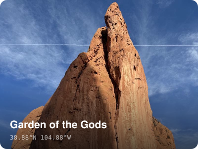
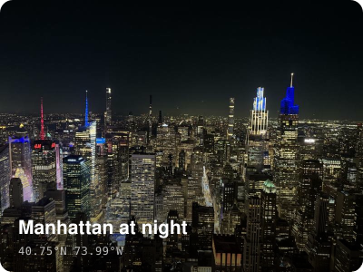
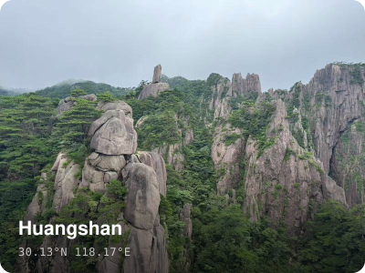

<p>
  <a href="https://vectorwei.github.io"></a>
</p>

I build things with LLMs — right now RAG systems and agent tools at **Monolithic Power Systems** in San Jose.
Before that: data science at **UChicago** and **SUSTech**, with a detour through AI product management at Lenovo.

Off the clock I'm usually behind a camera, on a trail, on a badminton court, or losing at board games.

<p>
  <a href="https://vectorwei.github.io"><picture><source media="(prefers-color-scheme: dark)" srcset=".github/readme/btn-website-dark.svg"></picture></a>
  <a href="https://vectorwei.github.io/posts/"><picture><source media="(prefers-color-scheme: dark)" srcset=".github/readme/btn-blog-dark.svg"></picture></a>
  <a href="https://vectorwei.github.io/cv.pdf"><picture><source media="(prefers-color-scheme: dark)" srcset=".github/readme/btn-cv-dark.svg"></picture></a>
  <a href="https://www.linkedin.com/in/jiawei-xiong-407a08314"><picture><source media="(prefers-color-scheme: dark)" srcset=".github/readme/btn-linkedin-dark.svg"></picture></a>
  <a href="mailto:jiaweix1@uchicago.edu"><picture><source media="(prefers-color-scheme: dark)" srcset=".github/readme/btn-email-dark.svg"></picture></a>
</p>

### Latest writing

<!-- BLOG-POST-LIST:START -->- [联想AI产品经理实习体验](https://vectorwei.github.io/blog/AIPM_experience/) <sub>Jul 2025</sub>
- [Uchi ADS一年就读体验](https://vectorwei.github.io/blog/uchi-ads-experience/) <sub>Jun 2025</sub>
- [我为什么突然想做AI产品经理](https://vectorwei.github.io/blog/whyPM/) <sub>Apr 2025</sub>
- [My First Post at This Site](https://vectorwei.github.io/blog/first-post/) <sub>Mar 2025</sub>
- [Berkeley往事（下）](https://vectorwei.github.io/blog/berkeley2/) <sub>Dec 2023</sub>
<!-- BLOG-POST-LIST:END -->

<sub>Mostly in Chinese. This list updates itself from the blog's feed.</sub>

### Through my lens

<p>
  <a href="https://vectorwei.github.io/photos/colorado/"></a>
  <a href="https://vectorwei.github.io/photos/NY/"></a>
  <a href="https://vectorwei.github.io/photos/huangshan/"></a>
</p>

<sub>More in the <a href="https://vectorwei.github.io/photos/">photo gallery</a>.</sub>

<br>

<details>
<summary><sub>About this repo</sub></summary>

<br>

This is the source of [vectorwei.github.io](https://vectorwei.github.io), built with Jekyll. Theme files are vendored from [Minimal Mistakes](https://github.com/mmistakes/minimal-mistakes) (MIT, see `LICENSE`) and customized locally.

```bash
bundle install
LANG=en_US.UTF-8 bundle exec jekyll serve
```

</details>
